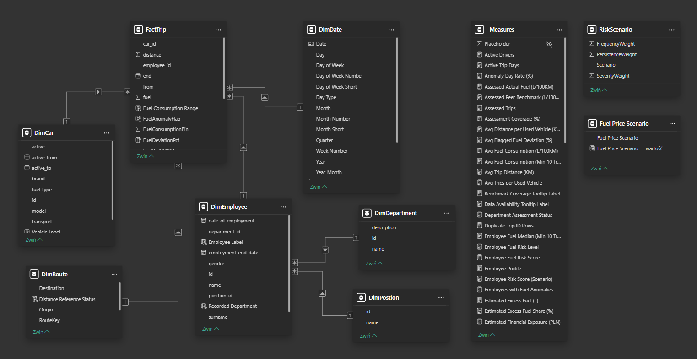

# FLEETGUARD
### Fleet Fraud Detection & Analytics

**End-to-End Data Analytics Project | Power BI | Power Query | DAX | Statistical Benchmarking**

FLEETGUARD is an interactive fleet analytics solution designed to identify unusual fuel consumption patterns, assess employee-level risk, analyze mileage consistency, monitor vehicle utilization, and estimate potential financial exposure.

The project demonstrates an end-to-end analytical workflow, from data preparation and semantic modeling to anomaly detection, interactive reporting, and business-oriented interpretation.

**All data used in this project is synthetic and intended for demonstration purposes.**

---

## Live Interactive Dashboard

### [View FLEETGUARD Interactive Power BI Report](https://app.powerbi.com/view?r=eyJrIjoiY2ZkMTBhMjctYWExYy00MzQ5LTljZGEtZDdjMDM4ZjI2YjdlIiwidCI6IjJmYWI1MTA4LTBiM2UtNDYwMy05Yjc3LTM2Y2QyYzk0ZmEzZSJ9&pageName=1873d2e93ba65ee9c949)

Explore the complete interactive dashboard directly in your browser.

The report allows users to:

- Explore fuel consumption anomalies.
- Compare employees using an audit-priority risk score.
- Investigate individual employees and trips.
- Analyze routes and mileage consistency.
- Monitor travel behavior and fleet utilization.
- Estimate financial exposure under different fuel price scenarios.
- Review data quality, benchmark coverage, and analytical limitations.

**No Power BI account is required to view the public report.**

---

## 1. Project Overview

### Business Context

Vehicle fleets generate large volumes of operational data, including information about trips, distances, vehicles, drivers, and fuel consumption.

Analyzing these records can help organizations identify unusual patterns, improve operational transparency, and prioritize areas requiring further investigation.

However, unusually high fuel consumption does not automatically indicate fraud. Differences may arise from vehicle characteristics, routes, driving conditions, operational requirements, or data quality issues.

FLEETGUARD addresses this challenge through peer-based benchmarking and transparent analytical rules.

### Project Objectives

The main objectives of this project are to:

1. Identify fuel consumption anomalies using comparable historical trips.
2. Evaluate employee-level patterns and prioritize potential audit cases.
3. Assess mileage consistency across comparable routes.
4. Examine employee travel behavior and weekend activity.
5. Analyze fleet utilization and vehicle activity.
6. Estimate potential financial exposure using adjustable fuel prices.
7. Evaluate data quality and benchmark coverage.
8. Provide an interactive environment for investigating unusual records.

The solution focuses on **anomaly detection and investigation prioritization**, not automated fraud determination.

---

## 2. Dataset Overview

The analysis is based on a synthetic fleet dataset consisting of 64 Excel source files.

Each trip record contains information about the employee, vehicle, trip dates, origin, destination, distance, and reported fuel consumption.

### Dataset Summary

| Metric | Value |
|---|---:|
| Source Files | 64 Excel files |
| Recorded Trips | 4,432 |
| Total Distance | 666,300 KM |
| Recorded Fuel Consumption | 77,104.16 L |
| Active Drivers | 14 |
| Vehicles Used | 8 |
| Route Pairs Used | 12 |
| Years Represented | 2023 and 2026 |

### Data Availability

The dataset contains:

- **2023:** 842 recorded trips.
- **2024:** No records available.
- **2025:** No records available.
- **2026:** 3,590 recorded trips.

Missing records for 2024–2025 do not necessarily indicate that no fleet activity occurred during those years.

Some records are also dated in the future relative to the analysis date and require source-level verification before being interpreted as completed trips.

---

## 3. Data Preparation & Transformation

Data preparation was performed using **Power Query** in Power BI Desktop.

The workflow included:

- Importing and consolidating 64 Excel files.
- Standardizing column names and data types.
- Validating trip identifiers, distances, and fuel values.
- Preparing date and employee attributes.
- Creating route identifiers for comparative analysis.
- Calculating trip-level fuel consumption in L/100KM.
- Structuring the data for analytical modeling.

The transformed data was organized into a semantic model supporting interactive reporting and advanced DAX calculations.

---

## 4. Data Model & Semantic Model

FLEETGUARD uses a **star-schema-based semantic model** with a central trip fact table and supporting dimensions.

The model separates transactional trip information from descriptive attributes, enabling consistent filtering and reusable analytical measures.

### Main Tables

| Table | Purpose |
|---|---|
| `FactTrip` | Central fact table containing trip-level records |
| `DimDate` | Calendar attributes and time-based analysis |
| `DimEmployee` | Employee information and department attributes |
| `DimCar` | Vehicle information |
| `DimRoute` | Route identifiers and origin-destination attributes |
| `DimDepartment` | Department reference data |
| `DimPosition` | Employee position reference data |
| `_Measures` | Dedicated table for organized DAX measures |

The analytical model uses relationships between fact and dimension tables to support filtering and aggregation.

### Semantic Model Diagram

### Explore the Technical Implementation

The complete Power BI project is available in **PBIP format**, allowing technical reviewers to examine the report and semantic model definitions.

**[Browse the Complete Power BI Project (PBIP)](FLEETGUARD_Project/)**

**[Explore the Semantic Model](FLEETGUARD_Project/FLEETGUARD_Project.SemanticModel/)**

**[Explore the Report Definition](FLEETGUARD_Project/FLEETGUARD_Project.Report/)**

The project provides access to:

- Semantic model structure.
- Tables and columns.
- Relationships and filtering configuration.
- DAX measures and calculated columns.
- Power Query transformation definitions.
- Report pages and visual configurations.

**Note:** Opening or refreshing the project locally may require configuring the original data sources.

---

## 5. Analytical Methodology

### 5.1 Fuel Anomaly Detection

Fuel anomaly detection is based on peer benchmarking rather than a universal consumption threshold.

For each trip, reported fuel consumption is compared with a reference value derived from comparable trips.

The reference is calculated using the **median fuel consumption of other drivers using the same vehicle and route pair**.

A valid benchmark requires:

- At least 20 comparable peer trips.
- Trips performed by at least two other drivers.
- The same vehicle.
- The same route pair.

Trips without sufficient reference data are classified as unassessed.

A trip is flagged when its fuel consumption exceeds the peer benchmark by **50% or more**.

The benchmark is calculated from the full historical dataset and does not recalculate when report slicers are changed.

This approach helps identify unusual fuel consumption while accounting for vehicle- and route-specific differences.

### 5.2 Employee Risk Scoring

FLEETGUARD includes an employee-level audit-priority score ranging from **0 to 100**.

The score combines three components:

| Component | Weight |
|---|---:|
| Anomaly Frequency | 50% |
| Anomaly Severity | 30% |
| Anomaly Persistence | 20% |
| **Total** | **100%** |

The model evaluates:

**Frequency:** How often an employee's assessed trips are flagged.

**Severity:** The magnitude of fuel consumption deviations.

**Persistence:** Whether unusual consumption patterns occur repeatedly.

A valid employee risk assessment requires:

- At least 20 assessed trips.
- At least 70% fuel benchmark coverage.

Employees with insufficient evidence are identified separately.

### Risk Classification

| Risk Score | Classification |
|---|---|
| 0–39 | Low |
| 40–74 | Medium |
| 75–100 | High |

The score is intended to **prioritize audit investigations**.

It is not a probability of fraud and does not establish employee misconduct.

### 5.3 Mileage Consistency Analysis

Mileage consistency is assessed by comparing recorded trip distances with route-specific peer benchmarks.

A valid mileage benchmark requires:

- At least 20 comparable peer trips.
- Trips performed by at least two other drivers.
- The same pair of locations.

Mileage assessment is not restricted to the same vehicle.

Generic destinations, such as `Sklep` and `Urząd`, are excluded from mileage benchmarking because they do not identify sufficiently specific locations.

Mileage deviations are evaluated to identify inconsistencies in recorded travel distances.

### 5.4 Financial Exposure Estimation

Potential financial exposure is estimated using excess fuel consumption identified in flagged trips.

The calculation compares actual recorded fuel consumption with expected consumption based on the relevant peer benchmark.

The resulting excess fuel estimate is multiplied by an adjustable fuel price.

**Estimated Financial Exposure = Estimated Excess Fuel × Selected Fuel Price**

A Power BI what-if parameter allows users to evaluate different fuel price scenarios.

The resulting values are analytical estimates, not confirmed financial losses.

---

## 6. Key Analytical Findings

### Fuel Anomaly Detection

| Metric | Result |
|---|---:|
| Total Trips | 4,432 |
| Fuel-Assessed Trips | 3,980 |
| Unassessed Trips | 452 |
| Fuel Assessment Coverage | 89.8% |
| Flagged Fuel Trips | 648 |
| Fuel Anomaly Rate | 16.3% |

**Key observation:**

648 trips exceeded their peer fuel consumption benchmarks by at least 50%.

The anomaly rate is calculated using assessed trips, not all recorded trips.

A relatively small number of employees account for the identified fuel anomalies, making employee-level investigation particularly relevant.

### Mileage Consistency

| Metric | Result |
|---|---:|
| Mileage-Assessed Trips | 4,336 |
| Mileage Assessment Coverage | 97.8% |
| Minimum Mileage Deviation | -4.8% |
| Maximum Mileage Deviation | +4.9% |

**Key observation:**

Mileage differences remain within a relatively narrow range for assessed trips.

Consequently, no separate mileage anomaly alerts were introduced.

The analysis demonstrates that not every analytical dimension requires an anomaly classification when the observed evidence does not justify one.

### Financial Exposure

| Metric | Result |
|---|---:|
| Flagged Actual Fuel | 21,350.60 L |
| Flagged Benchmark Fuel | 9,206.93 L |
| Estimated Excess Fuel | 12,143.67 L |

**Key observation:**

The model estimates approximately **12,143.67 liters of excess fuel consumption** across flagged trips.

Potential financial exposure depends on the fuel price selected in the report.

These values represent scenario-based analytical estimates and should not be interpreted as verified financial losses.

### Data Quality

The implemented validation checks identified:

| Validation Metric | Result |
|---|---:|
| Duplicate Trip ID Rows | 0 |
| Invalid Distance Trips | 0 |
| Invalid Fuel Trips | 0 |

These results indicate that no records failed the implemented validation rules.

They do not establish that every reported trip, distance, or fuel quantity is factually accurate.

---

## 7. Interactive Power BI Report

The Power BI report contains eight main analytical pages and a dedicated employee investigation drill-through page.

### Report Pages

| Page | Description |
|---|---|
| **01 — Executive Overview** | High-level KPIs, anomaly trends, and employee risk indicators |
| **02 — Employee Risk Ranking** | Employee-level audit-priority scoring and risk comparison |
| **03 — Fuel Consumption Audit** | Fuel consumption distributions, vehicle benchmarks, and anomalies |
| **04 — Route & Mileage Audit** | Route distance analysis and mileage consistency |
| **05 — Travel Behavior Analysis** | Travel patterns, weekday/weekend activity, and employee behavior |
| **06 — Fleet Utilization** | Vehicle usage, trip frequency, and operational activity |
| **07 — Financial Exposure Analysis** | Excess fuel estimates and interactive fuel price scenarios |
| **08 — Data Quality & Methodology** | Data validation, benchmark coverage, and analytical limitations |

### Employee Investigation

A dedicated **Employee Investigation** page supports drill-through analysis from the employee ranking.

The investigation view provides:

- Employee-level KPIs.
- Fuel anomaly metrics.
- Vehicle-level comparisons.
- Route-level comparisons.
- Detailed trip-level deviations.

This allows users to move from high-level risk identification to individual record investigation.

---

## 8. Power BI Features & Technical Skills

The project demonstrates the following capabilities.

### Data Preparation

- Power Query data transformation.
- Consolidation of multiple Excel files.
- Data type standardization.
- Data validation and quality checks.
- Calculated analytical attributes.

### Data Modeling

- Star-schema-based semantic modeling.
- Fact and dimension tables.
- Model relationships.
- Date dimension.
- Dedicated measure organization.
- Calculated columns and reusable DAX measures.

### Advanced Analytics

- Statistical peer benchmarking.
- Median-based reference calculations.
- Fuel consumption normalization (L/100KM).
- Anomaly detection.
- Employee risk scoring.
- Mileage consistency analysis.
- Scenario-based financial estimation.

### Report Development

- Interactive KPIs.
- Cross-filtering.
- Synchronized slicers across selected dashboard pages.
- Page navigation.
- Drill-through investigations.
- Bookmark-based chart switching.
- Custom report page tooltips.
- What-if parameters.
- Dynamic DAX calculations.
- Data quality and methodology documentation.

---

## 9. Tools & Technologies

| Technology | Application |
|---|---|
| Power BI Desktop | Data modeling, DAX, and report development |
| Power Query | Data import and transformation |
| DAX | Analytical calculations and risk scoring |
| Power BI Service | Interactive report publishing |
| PBIP | Source-controlled Power BI project structure |
| Git & GitHub | Version control and portfolio publication |
| Microsoft Excel | Synthetic source data |

---

## 10. Repository Structure

The repository contains the Power BI implementation, supporting data, analytical materials, and project documentation.

### Power BI Project

**[FLEETGUARD_Project](FLEETGUARD_Project/)**

Contains the Power BI project in PBIP format, including:

- `FLEETGUARD_Project.pbip`
- `FLEETGUARD_Project.Report/`
- `FLEETGUARD_Project.SemanticModel/`

### Additional Project Resources

| Directory | Contents |
|---|---|
| [`FLEETGUARD_Project/`](FLEETGUARD_Project/) | Power BI project and semantic model |
| [`screenshots/`](screenshots/) | Visual documentation and report screenshots |
| [`data/`](data/) | Source data files |
| [`additional-python-analysis/`](additional-python-analysis/) | Additional Python analysis |
| [`raport-PowerBI/`](raport-PowerBI/) | Power BI-related project materials |

The interactive version of the report is available through the public Power BI link provided at the beginning of this README.

---

## 11. Methodological Limitations

Several limitations should be considered when interpreting the results.

**Synthetic data**

The dataset is entirely fictional and does not represent a real organization's operational records.

**Incomplete historical coverage**

Data is available for 2023 and 2026, with no records for 2024–2025.

**Future-dated records**

Some records contain dates later than the analysis date and require additional verification.

**No detailed GPS information**

Exact driving routes and geographic trajectories are unavailable.

**Historical organizational structure**

Historical department assignments are not available, limiting the interpretation of department-level changes over time.

**Unverified fuel quantities**

Recorded fuel consumption has not been independently reconciled with fuel purchases.

**Benchmark availability**

Not every trip has sufficient comparable records to support peer benchmarking.

**Historical benchmark calculation**

Trip-level benchmarks are calculated using the complete dataset rather than recalculated for each interactive filter selection.

**Financial estimates**

Estimated excess fuel and financial exposure are model-based calculations, not confirmed losses.

---

## 12. Interpretation & Responsible Use

FLEETGUARD is designed as an analytical screening and investigation-support solution.

The presence of a fuel consumption anomaly does not establish fraud, intentional misconduct, or an employee's responsibility for financial loss.

Employee risk scores reflect the selected analytical methodology and should not be interpreted as probabilities of fraud.

The results should be considered starting points for additional investigation, supported by operational context and independent source verification.

**Detected anomalies are not confirmed fraud.**

**Estimated financial exposure is not confirmed financial loss.**

---

## 13. Project Summary

FLEETGUARD demonstrates how business intelligence and statistical analysis can be combined to develop a structured fleet monitoring and investigation-support solution.

The project integrates:

- Data preparation and validation.
- Semantic data modeling.
- Advanced DAX analytics.
- Peer-based anomaly detection.
- Employee risk prioritization.
- Operational performance analysis.
- Scenario-based financial estimation.
- Interactive dashboards and detailed investigations.
- Transparent analytical methodology.

The completed solution provides both a business-facing interactive report and an accessible technical implementation.

### Explore the Project

**[Launch Interactive Power BI Dashboard](https://app.powerbi.com/view?r=eyJrIjoiY2ZkMTBhMjctYWExYy00MzQ5LTljZGEtZDdjMDM4ZjI2YjdlIiwidCI6IjJmYWI1MTA4LTBiM2UtNDYwMy05Yjc3LTM2Y2QyYzk0ZmEzZSJ9&pageName=1873d2e93ba65ee9c949)**

**[Browse Power BI Source Project](FLEETGUARD_Project/)**

**[Explore Semantic Model](FLEETGUARD_Project/FLEETGUARD_Project.SemanticModel/)**

---

*FLEETGUARD is a portfolio demonstration project developed using synthetic data.*
